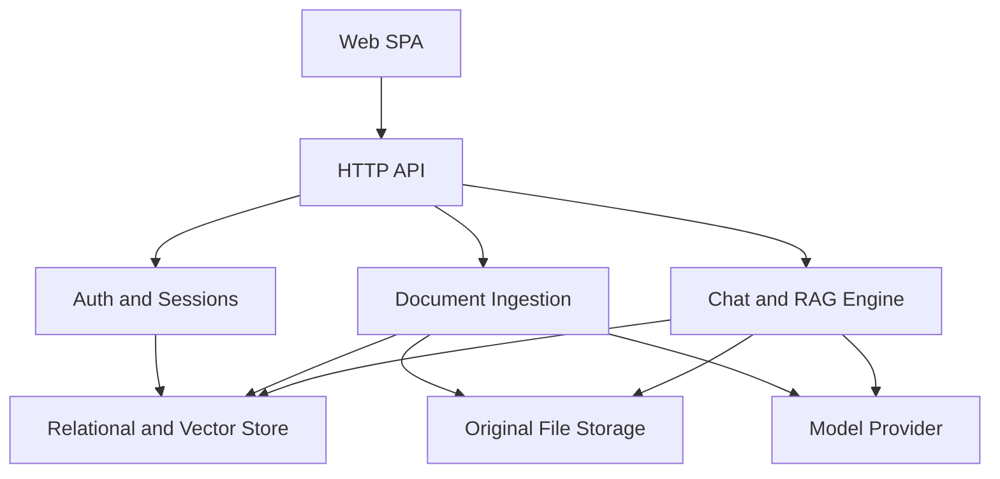
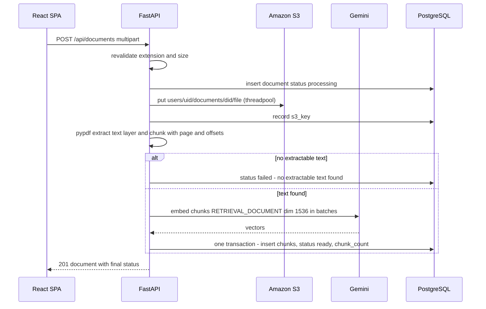
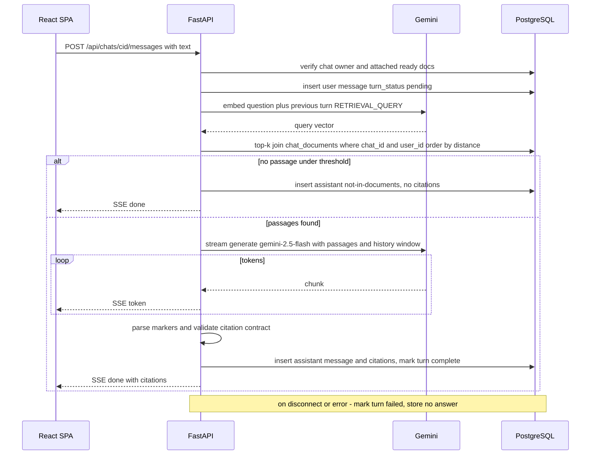
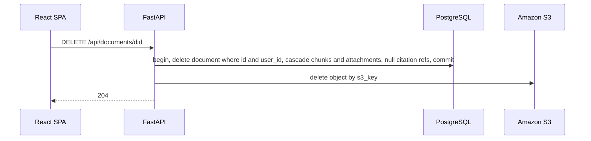
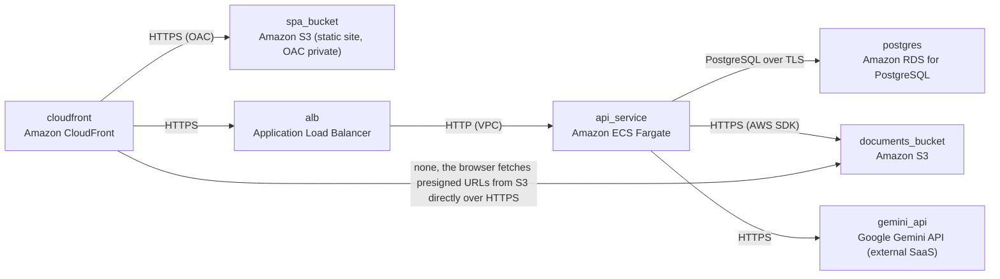

# Architecture

> Maintained by QuorQ AI SDLC. Text between `sdlc:auto` markers is regenerated; anything outside them is yours and is kept.

<!-- sdlc:auto:start narrative -->
## Overview

### ARCH-OVERVIEW · approved · source: architecture:summary

Approved Version 1 architecture for a private, per-user RAG chatbot. Users upload PDF, .txt or .md files and ask questions about them in named chats. Answers stream from Gemini 2.5 Flash and are grounded in pgvector retrieval with persisted citation snapshots.

Status: approved. Version: 1.
- Frontend: React 19 SPA served from CloudFront and S3.
- Backend: FastAPI 0.115 API on ECS Fargate.
- Authentication: email and password signup. Login creates a server-side session carried in a signed httpOnly cookie.
- Supported uploads: text-based PDF, .txt and .md.
  - The original file is stored in a private S3 bucket.
  - Text is extracted with pypdf, then chunked.
  - Chunks are embedded with gemini-embedding-001 (task type RETRIEVAL_DOCUMENT, 1536 dimensions).
  - Chunks are written to PostgreSQL 16 with pgvector.
  - All of this runs synchronously in one transaction inside the upload request, so a failure leaves no partial chunks.
- Chats:
  - Users create named chats and attach ready library documents.
  - Attaching adds a link row only; documents are never re-embedded.
- Each question turn:
  - The question is embedded with task type RETRIEVAL_QUERY.
  - One pgvector query runs, joined to the chat's attachments and the owner.
  - If nothing clears the relevance threshold, the reply 'not in your documents' is returned directly.
  - Otherwise, Gemini 2.5 Flash generates the answer and streams it over SSE. It runs at low temperature, with an instruction to answer only from the passages and a bounded window of recent turns.
- Persistence: the assistant message and its citation snapshot (document, page or chunk, passage text) are saved only when generation completes and passes a Pydantic citation contract.
- Document deletion:
  - Chunks and attachments are removed in one transaction.
  - The S3 object is then removed.
  - Historical citations stay visible, labelled 'deleted document'.
- Configuration is environment-driven and fails fast at startup.

**Related:** ARCH-COMP-web_spa, ARCH-COMP-api, ARCH-COMP-auth_service, ARCH-COMP-ingestion_service, ARCH-COMP-chat_service, ARCH-COMP-db, ARCH-COMP-object_store, ARCH-COMP-gemini, ARCH-CP-INGEST, ARCH-CP-CHAT-TURN, ARCH-CP-DELETE, ARCH-DEPLOY

- ⚠ The approver and approval date for this architecture are not stated in the input.
- ⚠ No mapping from components, endpoints or critical paths to user stories US-001 to US-024 is provided. Requirement-level traceability for this phase cannot be established from the input.
- ⚠ The rationale cites NFR-002, NFR-003, NFR-005, NFR-017, NFR-018, NFR-020, NFR-028 and NFR-029. None of these appear in the known requirement key list (US-001 to US-024). Their source and wording need confirmation.
- ⚠ No observability, monitoring or alerting design is described beyond logging of failed S3 deletes.
- ⚠ No rate limiting or abuse controls for uploads, chat turns or authentication attempts are described.
- ⚠ No industry or domain skill was named, so no compliance traceability was performed.

### ARCH-COMP-web_spa · approved · source: architecture:components:web_spa

Web SPA built with React 19. It provides every user-facing screen and handles token streaming of answers by parsing SSE over fetch.

Technology: React 19.

Responsibilities:
- Signed-in dashboard.
- Library with upload and upload progress.
- Chat pane with token streaming over fetch and SSE parsing.
- Attach panel for linking documents to a chat.
- Citation expanders.
- Account settings.
- Login and signup pages.
- Responsive layout.

Uses GET /api/auth/me for its route guard (per the endpoints list).

**Related:** ARCH-COMP-api, ARCH-TECH-FRONTEND, ARCH-DEPLOY

- ⚠ The account settings screen's contents beyond change password are not specified. For example, account deletion is not listed among the endpoints.
- ⚠ Upload progress is listed, but ingestion is synchronous with no progress endpoint. It is unclear whether progress means transfer progress only.

### ARCH-COMP-api · approved · source: architecture:components:api

HTTP API built with FastAPI 0.115. It handles routing, session-cookie authentication, owner-scoped request handling, upload validation, SSE streaming responses and fail-fast settings.

Technology: FastAPI 0.115.

Responsibilities:
- Routing.
- Session-cookie auth dependency on every route except signup and login.
- Owner-scoped request handling.
- Upload validation.
- SSE streaming responses.
- Fail-fast Pydantic settings (pydantic-settings, cited for NFR-028 in the backend technology decision).

**Related:** ARCH-COMP-auth_service, ARCH-COMP-ingestion_service, ARCH-COMP-chat_service, ARCH-TECH-BACKEND, NFR-028

- ⚠ GET /api/health is presumably unauthenticated for the load balancer, but the component description says the auth dependency applies to every route except signup and login. This is a discrepancy that needs confirmation.
- ⚠ CSRF protection for cookie-authenticated state-changing requests is not described.
- ⚠ Cookie attributes beyond 'signed httpOnly' (for example Secure, SameSite) are not specified.

### ARCH-COMP-auth_service · approved · source: architecture:components:auth_service

Auth and Sessions module in FastAPI 0.115. It handles signup, login, logout and change password using argon2 hashing and server-side hashed session tokens. It runs a dummy hash on unknown emails to prevent timing-based account enumeration.

Technology: FastAPI 0.115.

Responsibilities:
- Signup, login, logout and change password.
- Passwords are hashed with argon2.
- Random session tokens are issued and stored hashed in user_sessions.
- The signed cookie is verified on each request.
- Logout revokes the session.
- A dummy hash runs on unknown emails, so response timing does not reveal whether an account exists.

**Related:** ARCH-COMP-api, ARCH-DATA-MODEL, ARCH-EP-AUTH

- ⚠ Session lifetime (expires_at duration) and any idle timeout are not specified.
- ⚠ It is not stated whether changing the password revokes other active sessions. users.password_changed_at exists, but its use is not described.
- ⚠ Password policy (minimum length or complexity) is not specified.
- ⚠ Password reset or recovery is not described.

### ARCH-COMP-ingestion_service · approved · source: architecture:components:ingestion_service

Document Ingestion module in FastAPI 0.115. It revalidates uploads, stores originals in S3, extracts and chunks text, batch-embeds the chunks and writes them in one transaction. It also supports retry from S3 and delete.

Technology: FastAPI 0.115.

Responsibilities:
- Server-side revalidation of file extension and size.
- S3 put under users/{user_id}/documents/{document_id}.
- Text extraction: pypdf text-layer extraction for PDFs, or a raw text read for .txt and .md.
- Overlapping chunking that tracks page number and character offsets.
- Batch embedding with task type RETRIEVAL_DOCUMENT.
- A single-transaction chunk write.
- Document status is set to ready or failed.
- Retry from S3.
- Delete.
- Blocking work runs in a threadpool (run_in_threadpool, cited for NFR-005).

**Related:** ARCH-CP-INGEST, ARCH-COMP-object_store, ARCH-COMP-gemini, ARCH-COMP-db, ARCH-EP-DOCUMENTS, NFR-005, NFR-020

- ⚠ The maximum upload size is not specified.
- ⚠ Chunk size and overlap values are not specified.
- ⚠ Embedding batch size, and handling of Gemini rate limits or quotas during batch embedding, are not specified.
- ⚠ The outcome for PDFs with no text layer (scanned or image-only) is not explicitly described, beyond the general failed status. The wording of failure_reason is not specified.
- ⚠ Text encoding handling for .txt and .md files is not specified.

### ARCH-COMP-chat_service · approved · source: architecture:components:chat_service

Chat and RAG Engine module in FastAPI 0.115. It handles chat CRUD, attach and detach, history, and per-turn retrieval plus grounded streaming generation, including citation validation and retry of failed turns.

Technology: FastAPI 0.115.

Responsibilities:
- Chat CRUD.
- Attach and detach documents.
- Chat history.
- Per-turn orchestration:
  - Embed the question (task type RETRIEVAL_QUERY).
  - Run a chat-scoped pgvector top-k query with a relevance threshold.
  - Assemble the prompt with a bounded history window.
  - Stream the answer from Gemini 2.5 Flash.
  - Parse citations.
  - Validate the Pydantic citation contract.
  - Persist on completion.
  - Mark failed turns, with retry available.

**Related:** ARCH-CP-CHAT-TURN, ARCH-COMP-gemini, ARCH-COMP-db, ARCH-EP-CHATS, NFR-002, NFR-029

- ⚠ The top-k value, the relevance threshold value and the history window size N are not specified.
- ⚠ Behaviour when a chat has no attached documents is not described.

### ARCH-COMP-db · approved · source: architecture:components:db

Relational and vector store on PostgreSQL 16 with pgvector. It holds all application data, including chunk embeddings in an HNSW cosine index. Owner and attachment scoping is enforced through SQL joins, with cascading deletes.

Technology: PostgreSQL 16.

Stores:
- users and sessions.
- documents.
- chunks, with vector(1536) and an HNSW cosine index.
- chats and chat_documents.
- messages and citation snapshots.

Owner and attachment scoping is enforced by SQL joins, with cascading deletes.

**Related:** ARCH-DATA-MODEL, ARCH-TECH-DATABASE, NFR-003, NFR-017, NFR-018

- ⚠ HNSW index parameters (m, ef_construction, ef_search) are not specified.

### ARCH-COMP-object_store · approved · source: architecture:components:object_store

Original file storage in a private Amazon S3 bucket, using per-user key prefixes. The API reads files back for ingestion retry and serves them via short-lived presigned GET URLs after an ownership check.

Technology: Amazon S3 (AWS).
- Private bucket holding original uploads under per-user key prefixes.
- The API reads objects to retry ingestion.
- The API issues short-lived presigned GET URLs after an ownership check.

**Related:** ARCH-COMP-ingestion_service, ARCH-CP-DELETE, ARCH-EP-DOCUMENTS

- ⚠ The presigned URL lifetime is not specified.

### ARCH-COMP-gemini · approved · source: architecture:components:gemini

External model provider: the Google Gemini API via the google-genai SDK. gemini-embedding-001 produces 1536-dimension embeddings and gemini-2.5-flash produces streamed grounded answers. Model names are configurable.

Technology: Google Gemini API (google-genai SDK).
- gemini-embedding-001 embeds both chunks and questions, with output_dimensionality 1536.
- gemini-2.5-flash generates streamed, grounded answers.
- Model names come from configuration.

**Related:** ARCH-COMP-ingestion_service, ARCH-COMP-chat_service, ARCH-DEPLOY

- ⚠ It is not stated whether reduced-dimension (1536) embeddings are normalized before cosine indexing.
- ⚠ Timeouts, retry or backoff policy, and quota handling for Gemini calls are not specified.

### ARCH-CP-INGEST · approved · source: architecture:critical_paths:Synchronous upload and ingestion

Critical path for upload and ingestion. Upload, storage, extraction, chunking, embedding and indexing all complete within one request, and the response returns the final status. Chunks are inserted atomically only after every embedding succeeds.

Steps:
1. Revalidate the upload.
2. Store the original file in S3.
3. Extract the text.
4. Chunk the text.
5. Embed the chunks.
6. Index the chunks.

All steps run within one request, and the response returns the final status.

Atomicity: chunks are inserted in one transaction only after every embedding succeeds, so a failure leaves zero searchable chunks (NFR-020).

Retry: deletes any existing chunks for the document, re-reads the object from S3 and re-runs the same pipeline.

**Related:** ARCH-COMP-ingestion_service, ARCH-COMP-object_store, ARCH-COMP-gemini, ARCH-COMP-db, ARCH-EP-DOCUMENTS, NFR-020

- ⚠ Synchronous ingestion of large files must finish within the ALB idle timeout of 120s. No file size or page limit is stated to guarantee this, and behaviour on timeout is not described.
- ⚠ It is not specified whether the S3 object is kept or removed when ingestion fails. Retry implies it is kept.

### ARCH-CP-CHAT-TURN · approved · source: architecture:critical_paths:Grounded streaming chat turn

Critical path for a grounded streaming chat turn. The question, plus the previous user turn, is embedded and retrieved in one chat-scoped SQL query. A canned reply is returned when nothing is relevant; otherwise gemini-2.5-flash streams an answer. Citations are validated before persistence, and failures store no partial answer.

Steps:
1. Persist the user message with turn_status pending.
2. Build the retrieval query text from the current question plus the previous user turn. This lets follow-up questions resolve without an extra model call (NFR-002).
3. Run one embedding call.
4. Run one SQL query that joins document_chunks to chat_documents, filters by chat_id and user_id, orders by cosine distance and applies a threshold.
5. If no passage clears the threshold, store the canned not-in-documents reply without a model call.
6. Otherwise, send numbered passages and the last N turns to gemini-2.5-flash at temperature 0.1, and relay tokens as SSE.
7. On completion:
   - Parse the [n] markers.
   - Validate them with the GroundedAnswer or NotInDocumentsAnswer Pydantic model.
   - Insert the assistant message and citation snapshots.
   - Mark the user turn complete.

Failure handling: client disconnect or a provider error marks the turn failed, and no partial answer is stored. Failed turns can be retried via POST /api/chats/{id}/messages/{message_id}/retry.

**Related:** ARCH-COMP-chat_service, ARCH-COMP-gemini, ARCH-COMP-db, ARCH-EP-CHATS, NFR-002, NFR-029

- ⚠ Behaviour when the model output fails Pydantic citation validation is not described. For example, it is unclear whether the turn is marked failed or regenerated, and what the user sees after already-streamed tokens.
- ⚠ The exact wording of the canned not-in-documents reply and the SSE event format are not specified.
- ⚠ The values of N (history turns) and the threshold are not specified.

### ARCH-CP-DELETE · approved · source: architecture:critical_paths:Document deletion with citation preservation

Critical path for document deletion. An owner-scoped deletion runs in one transaction and cascades to chunks and chat attachments. Citation snapshot text is preserved, and the S3 object is deleted after commit.

Steps:
1. Run an owner-scoped delete in one DB transaction.
2. Deleting the document row cascades to document_chunks and chat_documents.
3. Set message_citations.chunk_id and document_id to NULL. The snapshot text remains, and the UI renders it as a deleted document.
4. After commit, delete the S3 object.

S3 failure handling: if the S3 delete fails, the error is logged with the key only and retried once.

**Related:** ARCH-COMP-db, ARCH-COMP-object_store, ARCH-EP-DOCUMENTS, ARCH-DATA-MODEL, NFR-018

- ⚠ The outcome if the single S3 delete retry also fails is not described, for example reconciliation of orphaned objects.

### ARCH-DATA-MODEL · approved · source: architecture:entities

Eight entities make up the data model: users, user_sessions, documents, document_chunks, chats, chat_documents, messages and message_citations. Chunk embeddings live in document_chunks. Citation snapshots carry denormalized document name, page and passage text so they survive document deletion.

Entities and fields:
- users: id, email, password_hash, created_at, password_changed_at.
- user_sessions: id, user_id, token_hash, created_at, expires_at, revoked_at.
- documents: id, user_id, filename, format, size_bytes, s3_key, status, failure_reason, chunk_count, created_at.
- document_chunks: id, document_id, user_id, chunk_index, page_number, char_start, char_end, content, embedding.
  - embedding is vector(1536) with an HNSW cosine index, per the db component.
- chats: id, user_id, name, created_at, last_message_at.
- chat_documents: chat_id, document_id, attached_at.
- messages: id, chat_id, user_id, role, content, answer_kind, turn_status, reply_to_id, created_at.
- message_citations: id, message_id, ordinal, chunk_id, document_id, document_name, page_number, chunk_index, passage_text.
  - chunk_id and document_id are nulled when the document is deleted.

**Related:** ARCH-COMP-db, ARCH-COMP-auth_service, ARCH-CP-DELETE, ARCH-CP-CHAT-TURN

- ⚠ Allowed values are not enumerated for documents.status (ready and failed are mentioned; any intermediate state is not), messages.turn_status (pending, complete and failed are mentioned), messages.role and messages.answer_kind.
- ⚠ Cascade behaviour on chat deletion for message_citations is not explicitly stated. The DELETE /api/chats endpoint mentions messages and attachments only.
- ⚠ Uniqueness constraints (for example on users.email or on the chat_documents pair) are not stated.
- ⚠ page_number semantics for .txt and .md files (which have no pages) are not stated.

### ARCH-EP-AUTH · approved · source: architecture:endpoints

Five authentication endpoints cover signup, login, logout, the current user and password change.

- POST /api/auth/signup: create an account and sign in immediately.
- POST /api/auth/login: verify credentials and create a server-side session.
- POST /api/auth/logout: revoke the current session and clear the cookie.
- GET /api/auth/me: return the current user; used by the SPA route guard.
- POST /api/auth/change-password: change the password with current-password verification.

**Related:** ARCH-COMP-auth_service, ARCH-COMP-api

- ⚠ Request and response schemas and error codes are not specified.

### ARCH-EP-DOCUMENTS · approved · source: architecture:endpoints

Five document endpoints cover listing, synchronous upload and ingestion, retry, presigned file access and deletion.

- GET /api/documents: list the owner's documents, newest first, with attached chats.
- POST /api/documents: upload and ingest synchronously.
- POST /api/documents/{id}/retry: re-run ingestion from the stored S3 object.
- GET /api/documents/{id}/file-url: return a short-lived presigned GET URL for the original file.
- DELETE /api/documents/{id}: delete the document, its chunks, attachments and S3 object.

**Related:** ARCH-COMP-ingestion_service, ARCH-COMP-object_store, ARCH-CP-INGEST, ARCH-CP-DELETE

- ⚠ Pagination for the document list is not specified.
- ⚠ Error responses for oversized or unsupported files are not specified.

### ARCH-EP-CHATS · approved · source: architecture:endpoints

Ten chat endpoints cover chat CRUD, document attach and detach, message history, streamed question answering and failed-turn retry.

- GET /api/chats: list the owner's chats by last activity.
- POST /api/chats: create a chat named 'New chat <date>'.
- GET /api/chats/{id}: chat detail with attached documents.
- PATCH /api/chats/{id}: rename the chat.
- DELETE /api/chats/{id}: delete the chat, its messages and attachments.
- PUT /api/chats/{id}/documents/{document_id}: attach an owned, ready document (link only).
- DELETE /api/chats/{id}/documents/{document_id}: detach a document from the chat.
- GET /api/chats/{id}/messages: full ordered history with citations and turn status.
- POST /api/chats/{id}/messages: ask a question and stream the answer as text/event-stream.
- POST /api/chats/{id}/messages/{message_id}/retry: re-run retrieval and generation for a failed user turn.

**Related:** ARCH-COMP-chat_service, ARCH-CP-CHAT-TURN

- ⚠ The date format in the default chat name is not specified.
- ⚠ Pagination for the chat list and message history is not specified. Message history is described as 'full'.
- ⚠ Maximum chat name length and question length limits are not specified.

### ARCH-EP-HEALTH · approved · source: architecture:endpoints

A health endpoint provides liveness and a database check for the load balancer.

- GET /api/health: liveness and DB check for the load balancer.

**Related:** ARCH-DEPLOY, ARCH-COMP-api

- ⚠ It is not explicitly stated that this endpoint is exempt from session authentication (see ARCH-COMP-api).

### ARCH-DEPLOY · approved · source: architecture:deployment_nodes

AWS deployment with seven nodes. CloudFront fronts both the SPA bucket and the ALB on one origin so cookies work. The API runs on ECS Fargate, data lives in RDS PostgreSQL 16 with pgvector and a private S3 bucket, and Gemini is an external SaaS.

Nodes:
- cloudfront (Amazon CloudFront, CDN): routes /* to the SPA bucket and /api/* to the ALB on the same origin, so cookies work.
- spa_bucket (Amazon S3 static site, OAC private): hosts the React 19 static build.
- alb (Application Load Balancer, HTTPS): idle timeout 120s, to accommodate SSE and synchronous ingestion.
- api_service (Amazon ECS Fargate): runs the FastAPI 0.115 container under uvicorn; secrets are injected as task environment variables.
- postgres (Amazon RDS for PostgreSQL): PostgreSQL 16 with the vector extension, encrypted storage and automated backups.
- documents_bucket (Amazon S3): private bucket with block public access and SSE-S3; keys follow users/{user_id}/documents/{document_id}/.
- gemini_api (Google Gemini API, external SaaS): gemini-embedding-001 and gemini-2.5-flash.

**Related:** ARCH-TECH-CLOUD, ARCH-COMP-web_spa, ARCH-COMP-api, ARCH-COMP-db, ARCH-COMP-object_store, ARCH-COMP-gemini

- ⚠ The source of injected secrets (for example Secrets Manager or SSM) is not specified.
- ⚠ ECS task count, autoscaling and CPU or memory sizing are not specified.
- ⚠ The RDS instance class, Multi-AZ setting and backup retention period are not specified.
- ⚠ Environments (dev, staging, prod), networking (VPC and subnets) and the CI/CD pipeline are not described.
- ⚠ Discrepancy: the S3 key pattern ends with a trailing slash here (users/{user_id}/documents/{document_id}/) but not in the ingestion component (users/{user_id}/documents/{document_id}). The exact key layout needs confirmation.
- ⚠ CloudFront behaviour for long-lived SSE responses on /api/* (origin timeouts, caching disabled) is not specified.

### ARCH-TECH-FRONTEND · approved · source: architecture:technology_decisions:Frontend

React 19 was chosen over Vue 3 and Svelte. The app is built as a static SPA on CloudFront and S3.

Choice: React 19. Alternatives considered: Vue 3, Svelte.

Rationale:
- Built as a static SPA served from CloudFront and S3.
- React state cleanly separates the streaming assistant bubble from independently updating document statuses.
- react-router covers the dashboard, library, chat and settings routes.

**Related:** ARCH-COMP-web_spa

### ARCH-TECH-BACKEND · approved · source: architecture:technology_decisions:Backend

FastAPI 0.115 was chosen over Django and Express for async SSE streaming, threadpool offloading of blocking work and Pydantic-based contracts and config.

Choice: FastAPI 0.115. Alternatives considered: Django, Express.

Rationale:
- Async StreamingResponse relays Gemini tokens as SSE.
- run_in_threadpool keeps pypdf and boto3 off the event loop (NFR-005).
- Pydantic models enforce the citation contract (NFR-029).
- pydantic-settings provides fail-fast configuration (NFR-028).

**Related:** ARCH-COMP-api, NFR-005, NFR-028, NFR-029

- ⚠ NFR-005, NFR-028 and NFR-029 are not in the known requirement key list. Their definitions need to be sourced.

### ARCH-TECH-DATABASE · approved · source: architecture:technology_decisions:Database

PostgreSQL 16 with pgvector was chosen over PostgreSQL plus a separate vector database. This allows owner- and chat-scoped retrieval in a single SQL query and transactional cascading deletes.

Choice: PostgreSQL 16. Alternative considered: PostgreSQL plus a separate vector database.

Rationale:
- pgvector vector(1536) with an HNSW cosine index lets one SQL query join chunks to chat_documents and filter by owner (NFR-003, NFR-017).
- Cascading foreign keys delete chunks and attachments in the same transaction (NFR-018).

**Related:** ARCH-COMP-db, NFR-003, NFR-017, NFR-018

- ⚠ NFR-003, NFR-017 and NFR-018 are not in the known requirement key list. Their definitions need to be sourced.

### ARCH-TECH-CLOUD · approved · source: architecture:technology_decisions:Cloud

AWS was chosen over Google Cloud and Azure. It provides ECS Fargate for the API, CloudFront and S3 for the SPA, RDS for managed PostgreSQL 16 with pgvector, and S3 for original files.

Choice: AWS. Alternatives considered: Google Cloud, Azure.

Rationale:
- ECS Fargate runs the API container.
- CloudFront and S3 host the SPA.
- RDS provides managed PostgreSQL 16 with pgvector and backups.
- S3 stores the original files with presigned access.

**Related:** ARCH-DEPLOY

- ⚠ The input does not say why AWS was chosen over Google Cloud despite the Gemini dependency. Any cross-cloud latency or egress considerations are undocumented.
<!-- sdlc:auto:end narrative -->

<!-- sdlc:auto:start building-blocks -->
## Building Block View

| ID | Name | Technology | Responsibility | Depends on |
|---|---|---|---|---|
| web_spa | Web SPA | React 19 | Signed-in dashboard, library with upload and progress, chat pane with token streaming over fetch and SSE parsing, attach panel, citation expanders, account settings, login and signup pages, responsive layout. | api |
| api | HTTP API | FastAPI 0.115 | FastAPI 0.115 app. Handles routing, the session-cookie auth dependency on every route except signup and login, owner-scoped request handling, upload validation, SSE streaming responses and fail-fast Pydantic settings. | auth_service, ingestion_service, chat_service |
| auth_service | Auth and Sessions | FastAPI 0.115 | Signup, login, logout and change password. Hashes passwords with argon2, issues random session tokens stored hashed in user_sessions, verifies the signed cookie on each request, revokes the session on logout and runs a dummy hash on unknown emails so response timing does not reveal account existence. | db |
| ingestion_service | Document Ingestion | FastAPI 0.115 | Server-side extension and size revalidation, S3 put under users/{user_id}/documents/{document_id}, pypdf text-layer extraction or raw text read, overlapping chunking with page and offset tracking, batch embedding (RETRIEVAL_DOCUMENT), a single-transaction chunk write, ready or failed status, retry from S3 and delete. Blocking work runs in a threadpool. | db, object_store, gemini |
| chat_service | Chat and RAG Engine | FastAPI 0.115 | Chat CRUD, attach and detach, history, and per-turn orchestration: question embedding (RETRIEVAL_QUERY), a chat-scoped pgvector top-k query with a relevance threshold, prompt assembly with a bounded history window, Gemini 2.5 Flash streaming, citation parsing, Pydantic citation-contract validation, persistence on completion and failed-turn marking with retry. | db, gemini, object_store |
| db | Relational and Vector Store | PostgreSQL 16 | Stores users, sessions, documents, chunks with vector(1536) and an HNSW cosine index, chats, chat_documents, messages and citation snapshots. Owner and attachment scoping is enforced by SQL joins, with cascading deletes. | — |
| object_store | Original File Storage | Amazon S3 (AWS) | Private bucket holding original uploads under per-user key prefixes. The API reads it for retry and issues short-lived presigned GET URLs after an ownership check. | — |
| gemini | Model Provider | Google Gemini API (google-genai SDK) | gemini-embedding-001 for chunks and questions (output_dimensionality 1536) and gemini-2.5-flash for streamed grounded answers. Model names come from configuration. | — |

<!-- sdlc:auto:end building-blocks -->

<!-- sdlc:auto:start runtime -->
## Runtime View

### Synchronous upload and ingestion

The upload is revalidated, stored in S3, extracted, chunked, embedded and indexed within one request, and the response returns the final status. Chunks are inserted in one transaction only after every embedding succeeds, so a failure leaves zero searchable chunks (NFR-020). Retry deletes any existing chunks for the document, re-reads the object from S3 and re-runs the same pipeline.

- **Components:** web_spa, api, ingestion_service, object_store, gemini, db
- **Modules:** app/routers/documents.py, app/services/ingestion.py, app/services/extract.py, app/services/chunking.py, app/clients/gemini.py, app/clients/s3.py
- **Key functions:** validate_upload(filename, size, max_bytes), create_document(user_id, filename, fmt, size) -> Document, put_object(key, bytes), extract_pdf_pages(bytes) -> list[PageText], read_text(bytes) -> str, chunk_text(pages, size=1000, overlap=200) -> list[ChunkDraft], embed_documents(texts) -> list[list[float]], persist_chunks(document_id, user_id, drafts, vectors), mark_failed(document_id, reason), retry_ingestion(user_id, document_id)

### Grounded streaming chat turn

The user message is persisted with turn_status pending. The retrieval query text is the current question plus the previous user turn, so follow-ups resolve without an extra model call (NFR-002). One embedding call and one SQL query join document_chunks to chat_documents and filter by chat_id and user_id, ordered by cosine distance with a threshold. If no passage clears the threshold, the canned not-in-documents reply is stored without a model call. Otherwise numbered passages and the last N turns are sent to gemini-2.5-flash at temperature 0.1, and tokens are relayed as SSE. On completion the [n] markers are parsed and validated by the GroundedAnswer or NotInDocumentsAnswer Pydantic model, then the assistant message and citation snapshots are inserted and the user turn is marked complete. Client disconnect or a provider error marks the turn failed and stores no partial answer.

- **Components:** web_spa, api, chat_service, gemini, db
- **Modules:** app/routers/chats.py, app/services/rag.py, app/services/prompting.py, app/schemas/answers.py, app/clients/gemini.py
- **Key functions:** start_turn(user_id, chat_id, text) -> Message, build_retrieval_query(history, question) -> str, embed_query(text) -> list[float], search_passages(user_id, chat_id, vector, k, max_distance) -> list[Passage], build_prompt(passages, history_window, question) -> Contents, stream_answer(contents) -> AsyncIterator[str], parse_citations(answer, passages) -> GroundedAnswer \| NotInDocumentsAnswer, persist_assistant(turn, answer), mark_turn_failed(turn, reason), retry_turn(user_id, chat_id, message_id)

### Document deletion with citation preservation

An owner-scoped delete runs in one DB transaction. Deleting the document row cascades document_chunks and chat_documents. message_citations.chunk_id and document_id are set to NULL, so the snapshot text remains and the UI renders it as a deleted document. After commit the S3 object is deleted. If that delete fails, the error is logged with the key only and retried once.

- **Components:** api, ingestion_service, db, object_store
- **Modules:** app/routers/documents.py, app/services/ingestion.py
- **Key functions:** delete_document(user_id, document_id), delete_object(key)

<!-- sdlc:auto:end runtime -->

<!-- sdlc:auto:start deployment-view -->
## Deployment View

| Name | Service | Runtime | Scaling | Environment |
|---|---|---|---|---|
| cloudfront | Amazon CloudFront | CDN, routes /* to the SPA bucket and /api/* to the ALB on the same origin for cookies | managed | dev |
| spa_bucket | Amazon S3 (static site, OAC private) | React 19 static build | managed | dev |
| alb | Application Load Balancer | HTTPS, idle timeout 120s for SSE and synchronous ingestion | managed | dev |
| api_service | Amazon ECS Fargate | FastAPI 0.115 container (uvicorn), secrets injected as task env | 1 task in dev, horizontally scalable because sessions live in the DB | dev |
| postgres | Amazon RDS for PostgreSQL | PostgreSQL 16 with the vector extension, encrypted storage, automated backups | single-AZ small instance in dev | dev |
| documents_bucket | Amazon S3 | private bucket, block public access, SSE-S3, keys users/{user_id}/documents/{document_id}/ | managed | dev |
| gemini_api | Google Gemini API (external SaaS) | gemini-embedding-001, gemini-2.5-flash | provider-managed | dev |

| Source | Target | Protocol |
|---|---|---|
| cloudfront | spa_bucket | HTTPS (OAC) |
| cloudfront | alb | HTTPS |
| alb | api_service | HTTP (VPC) |
| api_service | postgres | PostgreSQL over TLS |
| api_service | documents_bucket | HTTPS (AWS SDK) |
| api_service | gemini_api | HTTPS |
| cloudfront | documents_bucket | none, the browser fetches presigned URLs from S3 directly over HTTPS |

<!-- sdlc:auto:end deployment-view -->

<!-- sdlc:auto:start decisions -->
## Architecture Decisions

| Layer | Choice | ADR |
|---|---|---|
| Frontend | React 19 | [ADR-0001](adr/frontend.md) |
| Backend | FastAPI 0.115 | [ADR-0002](adr/backend.md) |
| Database | PostgreSQL 16 | [ADR-0003](adr/database.md) |
| Cloud | AWS | [ADR-0004](adr/cloud.md) |
<!-- sdlc:auto:end decisions -->

<!-- sdlc:auto:start links -->
## Related Documents

- [Data Model](data-model.md)
- [API Specification](api/openapi.yaml)
- [Architecture Decision Records](adr/README.md)
<!-- sdlc:auto:end links -->
