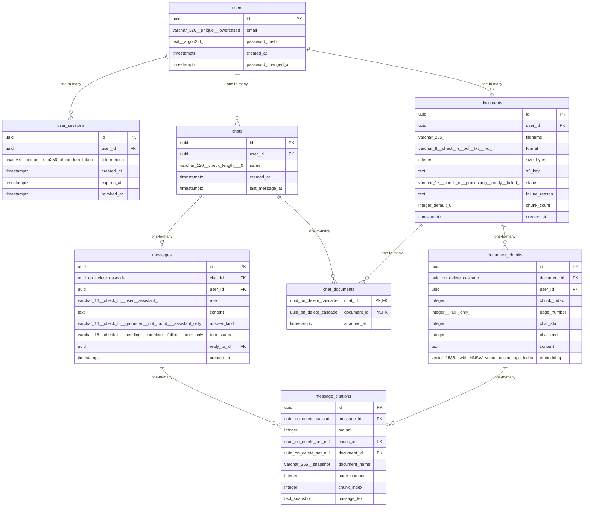

# Data Model

<!-- sdlc:auto:start entities -->
### users

| Field | Type | PK | FK | Nullable |
|---|---|---|---|---|
| id | uuid | True | — | False |
| email | varchar(320) unique, lowercased | False | — | False |
| password_hash | text (argon2id) | False | — | False |
| created_at | timestamptz | False | — | False |
| password_changed_at | timestamptz | False | — | True |

### user_sessions

| Field | Type | PK | FK | Nullable |
|---|---|---|---|---|
| id | uuid | True | — | False |
| user_id | uuid | False | users.id | False |
| token_hash | char(64) unique (sha256 of random token) | False | — | False |
| created_at | timestamptz | False | — | False |
| expires_at | timestamptz | False | — | False |
| revoked_at | timestamptz | False | — | True |

### documents

| Field | Type | PK | FK | Nullable |
|---|---|---|---|---|
| id | uuid | True | — | False |
| user_id | uuid | False | users.id | False |
| filename | varchar(255) | False | — | False |
| format | varchar(8) check in (pdf, txt, md) | False | — | False |
| size_bytes | integer | False | — | False |
| s3_key | text | False | — | True |
| status | varchar(16) check in (processing, ready, failed) | False | — | False |
| failure_reason | text | False | — | True |
| chunk_count | integer default 0 | False | — | False |
| created_at | timestamptz | False | — | False |

### document_chunks

| Field | Type | PK | FK | Nullable |
|---|---|---|---|---|
| id | uuid | True | — | False |
| document_id | uuid on delete cascade | False | documents.id | False |
| user_id | uuid | False | users.id | False |
| chunk_index | integer | False | — | False |
| page_number | integer (PDF only) | False | — | True |
| char_start | integer | False | — | False |
| char_end | integer | False | — | False |
| content | text | False | — | False |
| embedding | vector(1536) with HNSW vector_cosine_ops index | False | — | False |

### chats

| Field | Type | PK | FK | Nullable |
|---|---|---|---|---|
| id | uuid | True | — | False |
| user_id | uuid | False | users.id | False |
| name | varchar(120) check length > 0 | False | — | False |
| created_at | timestamptz | False | — | False |
| last_message_at | timestamptz | False | — | True |

### chat_documents

| Field | Type | PK | FK | Nullable |
|---|---|---|---|---|
| chat_id | uuid on delete cascade | True | chats.id | False |
| document_id | uuid on delete cascade | True | documents.id | False |
| attached_at | timestamptz | False | — | False |

### messages

| Field | Type | PK | FK | Nullable |
|---|---|---|---|---|
| id | uuid | True | — | False |
| chat_id | uuid on delete cascade | False | chats.id | False |
| user_id | uuid | False | users.id | False |
| role | varchar(16) check in (user, assistant) | False | — | False |
| content | text | False | — | False |
| answer_kind | varchar(16) check in (grounded, not_found), assistant only | False | — | True |
| turn_status | varchar(16) check in (pending, complete, failed), user only | False | — | True |
| reply_to_id | uuid | False | messages.id | True |
| created_at | timestamptz | False | — | False |

### message_citations

| Field | Type | PK | FK | Nullable |
|---|---|---|---|---|
| id | uuid | True | — | False |
| message_id | uuid on delete cascade | False | messages.id | False |
| ordinal | integer | False | — | False |
| chunk_id | uuid on delete set null | False | document_chunks.id | True |
| document_id | uuid on delete set null | False | documents.id | True |
| document_name | varchar(255) snapshot | False | — | False |
| page_number | integer | False | — | True |
| chunk_index | integer | False | — | False |
| passage_text | text snapshot | False | — | False |
<!-- sdlc:auto:end entities -->

<!-- sdlc:auto:start relationships -->
| Source | Target | Type |
|---|---|---|
| users | user_sessions | one-to-many |
| users | documents | one-to-many |
| documents | document_chunks | one-to-many |
| users | chats | one-to-many |
| chats | chat_documents | one-to-many |
| documents | chat_documents | one-to-many |
| chats | messages | one-to-many |
| messages | message_citations | one-to-many |
| document_chunks | message_citations | one-to-many |
<!-- sdlc:auto:end relationships -->

<!-- sdlc:auto:start er-diagram -->

<!-- sdlc:auto:end er-diagram -->
