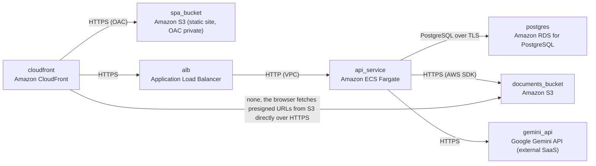

# Deployment Guide

> Maintained by QuorQ AI SDLC. Text between `sdlc:auto` markers is regenerated; anything outside them is yours and is kept.

<!-- sdlc:auto:start how-it-deploys -->
Pushes to `main` run `.github/workflows/deploy.yml`, which builds the API image (if there is a backend) and deploys the SPA to AWS Amplify. Commits touching only `docs/sdlc/**` don't deploy. Deployments can also be started from the platform's Deployment tab.
<!-- sdlc:auto:end how-it-deploys -->

<!-- sdlc:auto:start environments -->
| Name | Service | Runtime | Scaling | Environment |
|---|---|---|---|---|
| cloudfront | Amazon CloudFront | CDN, routes /* to the SPA bucket and /api/* to the ALB on the same origin for cookies | managed | dev |
| spa_bucket | Amazon S3 (static site, OAC private) | React 19 static build | managed | dev |
| alb | Application Load Balancer | HTTPS, idle timeout 120s for SSE and synchronous ingestion | managed | dev |
| api_service | Amazon ECS Fargate | FastAPI 0.115 container (uvicorn), secrets injected as task env | 1 task in dev, horizontally scalable because sessions live in the DB | dev |
| postgres | Amazon RDS for PostgreSQL | PostgreSQL 16 with the vector extension, encrypted storage, automated backups | single-AZ small instance in dev | dev |
| documents_bucket | Amazon S3 | private bucket, block public access, SSE-S3, keys users/{user_id}/documents/{document_id}/ | managed | dev |
| gemini_api | Google Gemini API (external SaaS) | gemini-embedding-001, gemini-2.5-flash | provider-managed | dev |
<!-- sdlc:auto:end environments -->

<!-- sdlc:auto:start live -->
**Frontend URL:** https://p318d0f073ea3.d3j61xaup4zgrx.amplifyapp.com

**Backend URL:** https://52-12-35-55.sslip.io/apps/318d0f073ea3/

**Database:** PostgreSQL · app

**Version:** 1b54677ca9a6

**Commit:** `1b54677`

**Finished:** 2026-10-27
<!-- sdlc:auto:end live -->

<!-- sdlc:auto:start topology -->

<!-- sdlc:auto:end topology -->
